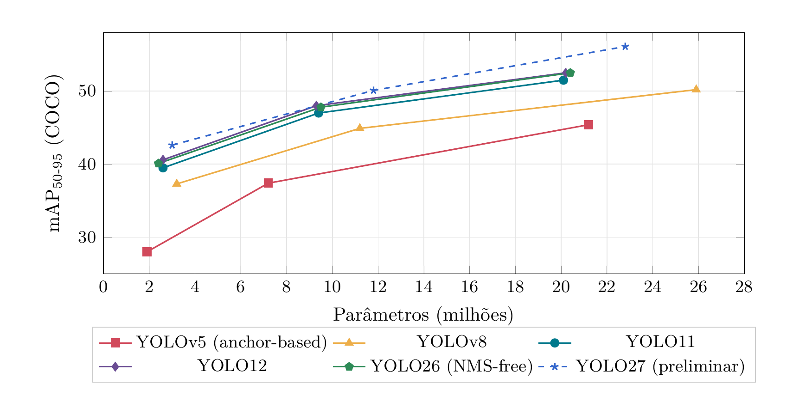

**Evolução YOLOv5 → YOLOv8 → YOLO11 e escolha do modelo para o P1**

- **Equipe:** Equipe Titans
- **Projeto:** Rover — Protótipo 1 (P1)
- **Responsáveis: Luiz, Roberto, Thomas
- **Data:** 3 de novembro de 2026

## 1. Evolução arquitetural

**Tabela 1:** Visão geral das mudanças por versão.

| Versão | Backbone / neck | Head | Loss / atribuição | Pós-proc. |
| --- | --- | --- | --- | --- |
| YOLOv5 (2020) | CSPDarknet com **C3**; stem conv 6 × 6; SPPF; neck PANet | **Acoplada, baseada em anchors** (3/célula), com *objectness* | BCE (obj + cls) + CIoU; atribuição por razão de forma | NMS |
| YOLOv8 (2023) | Blocos **C2f**; stem conv 3 × 3; SPPF; neck PANet com C2f | **Desacoplada, anchor-free**, sem *objectness* | BCE + CIoU + **DFL**; **Task-Aligned Assigner** | NMS |
| YOLO11 (2024) | Blocos **C3k2**; SPPF + **C2PSA** (atenção espacial) | Desacoplada, anchor-free; ramo de classe com convs *depthwise* | Igual ao YOLOv8 | NMS |
| YOLO12 (2025) | C3k2 nos estágios iniciais; **A2C2f** (*Area Attention* + R-ELAN) em P4/P5 e no neck | Igual ao YOLO11 | Igual ao YOLOv8 | NMS |
| YOLO26 (2026) | Igual ao YOLO11 (C3k2, SPPF, C2PSA) | Anchor-free, **sem DFL**; head **one-to-one** (end-to-end) | **ProgLoss** + **STAL**; otimizador MuSGD | **NMS-free** |
| YOLO27 (2026\*) | n/s: CNN simplificada, prediz em **2 escalas** (não 3); m: backbone estilo YOLO26 + **decoder transformer** | n/s: one-to-many + one-to-one opcional; m: **baseada em queries** | Não divulgada; n/s têm ramo de alinhamento de *foreground* só no treino | n/s: NMS‡ m: NMS-free |

<small>\* Anunciado em 13/09/2026; ainda sem pesos, sem suporte no pacote `ultralytics` e sem data de lançamento. ‡ NMS por padrão; NMS-free com `nms=False`.</small>

### 1.1 Trade-offs entre as variantes nano, small e medium

**Tabela 2:** Variantes n/s/m (COCO val2017, entrada 640 × 640). Latências em ms. Fontes: [[1]](#ref-1), [[2]](#ref-2), [[3]](#ref-3), [[4]](#ref-4), [[5]](#ref-5), [[6]](#ref-6).

| Versão | Modelo | Params (M) | GFLOPs | mAP₅₀₋₉₅ | CPU | GPU | No rover |
| --- | --- | ---: | ---: | ---: | ---: | ---: | ---: |
| **YOLOv5**ᵃ | YOLOv5n | 1,9 | 4,5 | 28,0 | 45 | 6,3 | <mark>[–]</mark> |
| | YOLOv5s | 7,2 | 16,5 | 37,4 | 98 | 6,4 | <mark>[–]</mark> |
| | YOLOv5m | 21,2 | 49,0 | 45,4 | 224 | 8,2 | <mark>[–]</mark> |
| **YOLOv8**ᵇ | YOLOv8n | 3,2 | 8,7 | 37,3 | 80,4 | 0,99 | <mark>[–]</mark> |
| | YOLOv8s | 11,2 | 28,6 | 44,9 | 128,4 | 1,20 | <mark>[–]</mark> |
| | YOLOv8m | 25,9 | 78,9 | 50,2 | 234,7 | 1,83 | <mark>[–]</mark> |
| **YOLO11**ᶜ | YOLO11n | 2,6 | 6,5 | 39,5 | 56,1 | 1,5 | <mark>[–]</mark> |
| | YOLO11s | 9,4 | 21,6 | 47,0 | 90,0 | 2,5 | <mark>[–]</mark> |
| | YOLO11m | 20,1 | 68,1 | 51,5 | 183,2 | 4,7 | <mark>[–]</mark> |
| **YOLO12**ᵈ | YOLO12n | 2,6 | 7,5 | 40,6 | – | 1,64 | <mark>[–]</mark> |
| | YOLO12s | 9,3 | 23,3 | 48,0 | – | 2,61 | <mark>[–]</mark> |
| | YOLO12m | 20,2 | 70,7 | 52,5 | – | 4,86 | <mark>[–]</mark> |
| **YOLO26**ᵉ | YOLO26n | 2,4 | 5,5 | 40,1 | 38,9 | 1,7 | <mark>[–]</mark> |
| | YOLO26s | 9,5 | 20,9 | 47,8 | 87,2 | 2,5 | <mark>[–]</mark> |
| | YOLO26m | 20,4 | 68,4 | 52,5 | 220,0 | 4,7 | <mark>[–]</mark> |
| **YOLO27**ᶠ | YOLO27n | 3,0 | 7,2 | 42,6 | 16,1 | 0,44 | <mark>[–]</mark> |
| | YOLO27s | 11,8 | 28,2 | 50,1 | 33,2 | 0,64 | <mark>[–]</mark> |
| | YOLO27m | 22,8 | 65,0 | 56,1 | 74,8 | 1,01 | <mark>[–]</mark> |

<small>

- ᵃ YOLOv5 v7.0 (anchor-based): CPU PyTorch, GPU NVIDIA V100 (batch 1).
- ᵇ YOLOv8: CPU ONNX, GPU NVIDIA A100 TensorRT.
- ᶜ YOLO11: CPU ONNX, GPU NVIDIA T4 TensorRT 10.
- ᵈ YOLO12: GPU NVIDIA T4 TensorRT FP16; a documentação não publica latência em CPU.
- ᵉ YOLO26: CPU ONNX, GPU NVIDIA T4 TensorRT 10, modo NMS-free; mAP do modo end-to-end (com a head one-to-many + NMS: 40,9 / 48,6 / 53,1); params e FLOPs do modelo fundido.
- ᶠ YOLO27 (**preliminar, não lançado**): CPU ONNX, GPU NVIDIA RTX PRO 6000 TensorRT 11; params e FLOPs do modelo fundido. A Ultralytics diz que o YOLO27n/s tem velocidade praticamente igual à do YOLO26n/s, então a CPU diferente deve explicar a latência bem menor.

As latências de YOLO11, YOLO12 e YOLO26 (T4) são comparáveis entre si; as demais vêm de outras máquinas e só se comparam entre tamanhos da mesma versão. A coluna “No rover” deve ser preenchida com `yolo benchmark` [[7]](#ref-7) executado no hardware real do rover.

</small>

**Figura 1:** Precisão versus tamanho do modelo. Em cada curva, os três pontos são as variantes n, s e m, da esquerda para a direita. YOLO11, YOLO12 e YOLO26 ficam acima e à esquerda do YOLOv5 e do YOLOv8: mais mAP com menos parâmetros. A curva tracejada do YOLO27 usa dados preliminares de um modelo ainda não lançado.

## 2. Conceitos de métricas

### 2.1 Métricas aplicadas ao cenário do rover

Uma detecção é **verdadeiro positivo (TP)** quando a classe está correta e a sobreposição com a caixa real ultrapassa um limiar de IoU (*Intersection over Union*):

$$
\text{IoU} = \frac{|B_{\text{pred}} \cap B_{\text{real}}|}{|B_{\text{pred}} \cup B_{\text{real}}|}
$$

Caso contrário, é **falso positivo (FP)**. Um objeto real que não foi detectado é um **falso negativo (FN)**. Classes do rover: <mark>[ex.: obstáculo, rocha, marcador ArUco, ferramenta]</mark>. As definições seguem o guia de métricas da Ultralytics [[8]](#ref-8) e o protocolo do COCO [[9]](#ref-9).

**Tabela 3:** Métricas de detecção. $\text{AP}_c$ é a *Average Precision* da classe $c$ e $N$ é o número de classes.

| Métrica | Definição | Interpretação no rover |
| --- | :---: | --- |
| Precision | $\dfrac{TP}{TP + FP}$ | Das detecções que o rover fez, quantas eram reais. Precision baixa gera *alarmes falsos*: o rover desvia ou para por obstáculos que não existem e perde tempo de missão. |
| Recall | $\dfrac{TP}{TP + FN}$ | Dos objetos que estavam na cena, quantos o rover encontrou. Recall baixo significa *obstáculo não visto* (risco de colisão) ou alvo da missão perdido. Para segurança, é a métrica mais crítica. |
| mAP₅₀ | $\dfrac{1}{N}\sum_{c=1}^{N} AP_c^{\,\text{IoU}=0{,}5}$ | Média, entre as classes, da área sob a curva Precision×Recall com IoU ≥ 0,5. Mede se o rover *encontra e identifica* os objetos, aceitando caixas aproximadas. Basta para decisões do tipo “há um obstáculo à frente”. |
| mAP₅₀₋₉₅ | $\dfrac{1}{10}\sum_{t\in\{0{,}50,\dots,0{,}95\}} \text{mAP}_t$ | Média do mAP em 10 limiares de IoU (de 0,50 a 0,95, passo 0,05). Premia caixas *bem ajustadas*. Importa quando a posição exata da caixa alimenta outra etapa, como estimar a distância de um objeto, alinhar o rover a um alvo ou agarrar com o braço. |

**Observação prática:** o limiar de confiança (`conf`) usado na inferência move o ponto de operação. Um `conf` baixo aumenta o recall e reduz a precision; um `conf` alto faz o contrário. Para o rover, sugere-se escolher o `conf` pela curva P–R de validação, priorizando recall nas classes de obstáculo. Meta do P1: mAP₅₀ ≥ <mark>[definir]</mark> e recall (obstáculos) ≥ <mark>[definir]</mark>.

## Referências

1. G. Jocher, *YOLOv5 by Ultralytics*, 2020. doi: [10.5281/zenodo.3908559](https://doi.org/10.5281/zenodo.3908559). Acesso em 2 de nov. de 2026. Endereço: <https://github.com/ultralytics/yolov5>.
2. Ultralytics. “Ultralytics YOLO26,” *Ultralytics Docs*, acesso em 3 de nov. de 2026. Endereço: <https://docs.ultralytics.com/models/yolo26/>.
3. Ultralytics. “YOLO12: Attention-Centric Object Detection,” *Ultralytics Docs*, acesso em 3 de nov. de 2026. Endereço: <https://docs.ultralytics.com/models/yolo12/>.
4. Ultralytics. “Ultralytics YOLO27,” *Ultralytics Docs*, acesso em 3 de nov. de 2026. Endereço: <https://docs.ultralytics.com/models/yolo27/>.
5. Ultralytics. “YOLOv8,” *Ultralytics Docs*, acesso em 2 de nov. de 2026. Endereço: <https://docs.ultralytics.com/models/yolov8/>.
6. Ultralytics. “YOLO11,” *Ultralytics Docs*, acesso em 2 de nov. de 2026. Endereço: <https://docs.ultralytics.com/models/yolo11/>.
7. Ultralytics. “Model Benchmarking with Ultralytics YOLO,” *Ultralytics Docs*, acesso em 2 de nov. de 2026. Endereço: <https://docs.ultralytics.com/modes/benchmark/>.
8. Ultralytics. “Performance Metrics Deep Dive,” *Ultralytics Docs*, acesso em 2 de nov. de 2026. Endereço: <https://docs.ultralytics.com/guides/yolo-performance-metrics/>.
9. T.-Y. Lin et al., “Microsoft COCO: Common Objects in Context,” em *European Conference on Computer Vision (ECCV)*, 2014, pp. 740–755.

## Histórico de versões

| Versão | Descrição | Data da edição | Editor |
| --- | --- | --- | --- |
| 1.0 | Versão inicial do estudo, com tabelas comparativas. | 04/11/2026 | Luiz |
